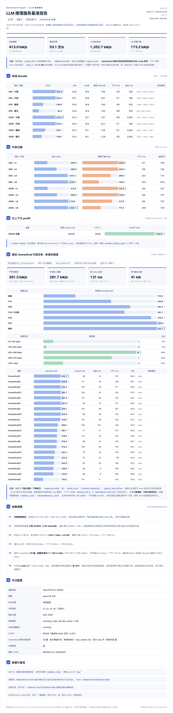

<div align="center">

<h1>HyperQwen-CMP170hx</h1>

<p><b>Qwen3.8-27B served fast on a CMP 170HX — 64 GiB HBM2e, 256K context, 413 tok/s single stream.</b></p>

<p>
<a href="https://github.com/vllm-project/vllm"></a>
<a href="LICENSE"></a>
</p>

**English** | [简体中文](README.md)

</div>

This repository is a **CMP 170HX adaptation branch** of
[syv-ai/HyperQwen](https://github.com/syv-ai/HyperQwen). Upstream serves
[Qwen3.8-27B](https://huggingface.co/Qwen/Qwen3.8-27B) + DFlash2 speculative
decoding on a 24 GiB RTX 3090; here the same vLLM 0.32.0 stack (about 50
patches + the KVarN long-context backend) is moved onto the **NVIDIA CMP
170HX** (GA100 / sm_80, VRAM unlocked to 64 GiB), with kernel tuning for this
card, GA100-required fixes, and a full measurement record.

## The card

| | |
|---|---|
| GPU | NVIDIA CMP 170HX — GA100 (sm_80), 74 SMs |
| Memory | **64 GiB HBM2e** (8 GiB is the public spec; this card is unlocked) |
| Interconnect | PCIe Gen2 |
| Driver | 610.57.04 |

What 64 GiB changes:

- **Context 64K → 256K** (`MAX_LEN=262136`); at `GPU_UTIL=0.90` the KV pool is
  about 589k tokens, so eight single-user streams at full long context still
  fit with room to spare;
- GA100 has **163 KB of shared memory per block** (sm86: 99 KB), so the
  split-KV verify kernel can use a 64-token KV tile — the physical basis of the
  [`opt-170hx/`](opt-170hx/) tuning;
- W4A16 weights take roughly 40% of the memory; nearly all the rest goes to KV.

Upstream lists sm_80 as carrying "an undiagnosed speculation fault"
([#98](https://github.com/syv-ai/HyperQwen/issues/98),
[#72](https://github.com/syv-ai/HyperQwen/issues/72)). This repository **could
not reproduce** it on driver 610.57.04 — note this is not the same as "the
fault is gone"; it is one more sm_80 datapoint. See
[docs/reproductions/cmp-170hx-64gb.md](docs/reproductions/cmp-170hx-64gb.md).

## Benchmark: 2026-11-09 end-to-end

One CMP 170HX (64 GiB) deployment; target model `Qwen3.8-27B-W4A16-AutoRound`
(W4A16: INT4 group-128 linear weights + BF16 activations, with the lm_head and
embeddings kept BF16, ~25 GB) + DFlash2 drafter (W4A16, ~1.3 GB), `CTX=fast`,
`NSEG=16`, `MIN_BATCH=0`, `MAX_SEQS=8`, 256K context. bench-web suite: 28
checks, 0 failures; `temperature=0`, per-item `cache_salt` to isolate the
prefix cache, streaming counted by token_ids (run ID `20261109-084416`):

<a href="opt-170hx/benchmarks/bench-20261109-084416.png"></a>

| metric | value |
|---|---|
| single-stream peak | **413.0 tok/s** (c1 · counting, 2000-token output, greedy) |
| real code, HumanEval (20 prompts, serial c1) | mean **301.3 tok/s** (P50 281.7 / P95 406.8 / max 422.7), TTFT 131 ms |
| concurrent aggregate | **1,352.7 tok/s** @ c8 (×3.28), 173.2 tok/s per client, TTFT 309 ms |
| long prefill | 69,503 tokens, TTFT 38.96 s → **1,783.8 tok/s** |
| verify-step rate | flat **52.3–53.1 steps/s** (18.8–19.1 ms/step) on every row |

The flat step rate means all throughput spread comes from how many speculative
tokens each verify step accepts (7.87 on counting @2000, 1.56 on prose @500),
not from the engine slowing down — the tuned verify kernel is no longer the
bottleneck at these lengths. Full tables, protocol and reproduction in
[`opt-170hx/README.md`](opt-170hx/README.md); full-page report:
[bench-20261109-084416.png](opt-170hx/benchmarks/bench-20261109-084416.png).

The upstream RTX 3090 numbers (127 tok/s single stream, ~1,035 tok/s at 64
concurrent, 150K context) are not the same protocol, power envelope or
concurrency cap — treat them as order-of-magnitude reference only, not an A/B.

## Changes vs upstream

1. **[`opt-170hx/`](opt-170hx/) — 170HX kernel tuning** (bind-mount four vLLM
   source files, no image rebuild): KV tile 32→64 at `D=256`, 8 warps for
   `D>128`, a batch-size gate for the FA2 fallback, fixed 16 KV segments.
   Same-seed A/B: C4/C8 32K verify-step time **~13% lower**, 128–256K single
   stream **+17–25%**, no regression on the 256/256 short protocol.
2. **GA100-required fixes** (not optional tuning): `VLLM_MARLIN_REPACK_STAGED=1`
   and `PYTORCH_CUDA_ALLOC_CONF=expandable_segments:False`, for the Marlin
   repack / allocator Xid 31 on this card.
3. **64 GiB context config**: `MAX_LEN=262136`, `MAX_SEQS=8`, `GPU_UTIL=0.90`.

## Quick start

Deployment is identical to upstream; the `.env` just gains one 170HX block:

```bash
git clone https://github.com/aiultrayang/HyperQwen-CMP170hx && cd HyperQwen-CMP170hx
cp .env.example .env
cat opt-170hx/170hx.env.example >> .env   # 170HX tuning + GA100-required fixes
docker compose --profile single up -d
```

- The first start pulls the image and requantizes the model once (~20 GB, into
  `./models`). In the env fragment, `MODEL` points at the AutoRound export
  layout (`/app/models/Qwen3.8-27B-W4A16-AutoRound`); every measurement in this
  repository uses that export + the DFlash2 drafter. If you use upstream's
  default prepare output instead, change `MODEL` to its actual path.
- By default only `127.0.0.1` is bound; before exposing it, set a key and open
  the bind:
  `echo "VLLM_API_KEY=$(openssl rand -hex 24)" >> .env && echo BIND=0.0.0.0 >> .env`
- Keep `VERIFY=0` while the bind mounts are active (`verify.sh` matches patch
  lines and would report these files as modified).
- Batch mode and multi-GPU TP are untested on this card; upstream's
  [batch/](batch/) and [docs/multi-gpu.md](docs/multi-gpu.md) still apply.

## Documentation

| | |
|---|---|
| [`opt-170hx/README.md`](opt-170hx/README.md) | 170HX tuning: changes, deployment, kernel A/B, the 2026-11-09 end-to-end benchmark |
| [`opt-170hx/patches/`](opt-170hx/patches/) | The same changes as patches (install without bind mounts) |
| [docs/reproductions/cmp-170hx-64gb.md](docs/reproductions/cmp-170hx-64gb.md) | Full record: the sm_80 fault investigation, 0.32.0 tuning and benchmarks |
| [PATCHES.md](PATCHES.md) · [docs/optimizations.md](docs/optimizations.md) · [single-user/](single-user/) | Upstream's patch list, optimization notes and operating manual (all apply here) |

## Acknowledgments

This repository is forked from
[syv-ai/HyperQwen](https://github.com/syv-ai/HyperQwen). The original project
targets the 24 GiB consumer RTX 3090: the vLLM 0.32.0 patch series (`patches/`),
the KVarN long-context backend (`kvarn/`), DFlash2 speculative decoding with
its 40k-token calibrated draft vocabulary (`drafter/`), the model requant
pipeline (`prepare/`), the container image and the bench suite all come from
the upstream project and its contributors. This branch does one thing: make
that stack run flat out on a CMP 170HX — kernel tuning, GA100 fixes and
measurements. The core work belongs to upstream.

## License

Apache-2.0, same as the model.
