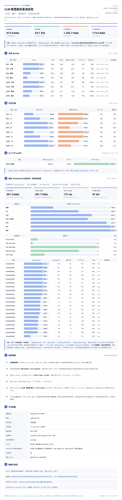

<div align="center">

<h1>HyperQwen-CMP170hx</h1>

<p><b>Qwen3.8-27B served fast on a CMP 170HX — 64 GiB HBM2e, 256K context, 413 tok/s single stream.</b></p>

<p>
<a href="https://github.com/vllm-project/vllm"></a>
<a href="LICENSE"></a>
</p>

**简体中文** | [English](README.en.md)

</div>

本仓库是 [syv-ai/HyperQwen](https://github.com/syv-ai/HyperQwen) 的
**CMP 170HX 适配分支**。上游把 [Qwen3.8-27B](https://huggingface.co/Qwen/Qwen3.8-27B)
+ DFlash2 投机解码跑在 24 GiB 的 RTX 3090 上；这里把同一套 vLLM 0.32.0 栈
（约 50 个补丁 + KVarN 长上下文后端）搬到 **NVIDIA CMP 170HX**（GA100 /
sm_80，显存解锁 64 GiB），针对这张卡做内核调优、GA100 必需修复，并留下完整
的实测记录。

## 这张卡

| | |
|---|---|
| GPU | NVIDIA CMP 170HX — GA100（sm_80），74 SM |
| 显存 | **64 GiB HBM2e**（公开规格 8 GiB，本卡已解锁） |
| 互联 | PCIe Gen2 |
| 驱动 | 610.57.04 |

64 GiB 改变了什么：

- **上下文 64K → 256K**（`MAX_LEN=262136`），`GPU_UTIL=0.90` 下 KV 池约
  58.9 万 token，单用户模式 8 路并发各自拉满长上下文仍有余量；
- GA100 每个 block **163 KB shared memory**（sm86 为 99 KB），split-KV verify
  kernel 因此能用 64-token KV tile —— 这是 [`opt-170hx/`](opt-170hx/) 调优的
  物理基础；
- W4A16 权重只占显存约四成，其余几乎全部给了 KV。

上游把 sm_80 列为"存在未定位的投机故障"
（[#98](https://github.com/syv-ai/HyperQwen/issues/98)、
[#72](https://github.com/syv-ai/HyperQwen/issues/72)）。本仓库在 610.57.04
驱动上**未能复现**该故障 —— 注意这不等价于"故障已消失"，只是第三块 sm_80 的
证据；调查过程见
[docs/reproductions/cmp-170hx-64gb.md](docs/reproductions/cmp-170hx-64gb.md)。

## 实测：2026-11-09 端到端基准

单张 CMP 170HX（64 GiB）部署，目标模型 `Qwen3.8-27B-W4A16-AutoRound`（W4A16：
INT4 group-128 线性层权重 + BF16 激活，lm_head/embedding 保持 BF16，约
25 GB）+ DFlash2 草模型（W4A16，约 1.3 GB），`CTX=fast`、`NSEG=16`、
`MIN_BATCH=0`、`MAX_SEQS=8`、256K 上下文。
bench-web 套件 28 项、0 失败；`temperature=0`，逐项 `cache_salt` 隔离前缀
缓存，流式按 token_ids 计数（run ID `20261109-084416`）：

<a href="opt-170hx/benchmarks/bench-20261109-084416.png"></a>

| 指标 | 数值 |
|---|---|
| 单流峰值 | **413.0 tok/s**（c1 · counting，2000 token 输出，greedy） |
| 真实代码 HumanEval（20 题，串行 c1） | 平均 **301.3 tok/s**（P50 281.7 / P95 406.8 / 最快 422.7），TTFT 131 ms |
| 并发聚合 | **1,352.7 tok/s** @ c8（×3.28），单客户端 173.2 tok/s，TTFT 309 ms |
| 长文本 prefill | 69,503 token，TTFT 38.96 s → **1,783.8 tok/s** |
| verify 步频 | 全部档位恒定 **52.3–53.1 步/s**（18.8–19.1 ms/步） |

步频恒定意味着吞吐差异全部来自每步被接受的投机 token 数（counting @2000 为
7.87，散文 @500 为 1.56），而不是引擎被压慢 —— 调优后的 verify kernel 在这些
长度上不再是瓶颈。完整表格、口径与复现方式见
[`opt-170hx/README.md`](opt-170hx/README.md)，长图报告：
[bench-20261109-084416.png](opt-170hx/benchmarks/bench-20261109-084416.png)。

与上游 RTX 3090 的数字（127 tok/s 单流、~1,035 tok/s @ 64 并发、150K 上下文）
不是同一协议、功耗档与并发上限，仅作量级参考，不构成 A/B。

## 相对上游的改动

1. **[`opt-170hx/`](opt-170hx/) — 170HX 内核调优**（bind-mount 四个 vLLM 源
   文件，不重建镜像）：`D=256` 时 KV tile 32→64、`D>128` 用 8 warps、按批量
   的 FA2 门控、固定 16 个 KV segment。同种子 A/B：C4/C8 32K verify 步时延
   **约 13% ↓**，128–256K 单流 **+17–25%**，256/256 短协议无回退。
2. **GA100 必需修复**（不是可选调优）：`VLLM_MARLIN_REPACK_STAGED=1` 与
   `PYTORCH_CUDA_ALLOC_CONF=expandable_segments:False`，规避 Marlin 重排与
   内存分配器在这张卡上的 Xid 31。
3. **64 GiB 上下文配置**：`MAX_LEN=262136`、`MAX_SEQS=8`、`GPU_UTIL=0.90`。

## 快速开始

部署流程与上游一致，只是 `.env` 多一段 170HX 配置：

```bash
git clone https://github.com/aiultrayang/HyperQwen-CMP170hx && cd HyperQwen-CMP170hx
cp .env.example .env
cat opt-170hx/170hx.env.example >> .env   # 170HX 调优 + GA100 必需项
docker compose --profile single up -d
```

- 首次启动拉取镜像并做一次性模型再量化（约 20 GB，写入 `./models`）。env 片段
  中 `MODEL` 指向 AutoRound 导出布局（`/app/models/Qwen3.8-27B-W4A16-AutoRound`）；
  本仓库全部实测使用该导出 + DFlash2 草模型，若用上游 prepare 的默认产物，按
  其实际输出路径改 `MODEL`。
- 默认只绑定 `127.0.0.1`；对外暴露前设置 key 并放开绑定：
  `echo "VLLM_API_KEY=$(openssl rand -hex 24)" >> .env && echo BIND=0.0.0.0 >> .env`
- bind-mount 生效期间保持 `VERIFY=0`（`verify.sh` 按补丁行匹配，会把这些文件
  报成已修改）。
- batch 模式与多卡 TP 未在这张卡上实测；上游的 [batch/](batch/)、
  [docs/multi-gpu.md](docs/multi-gpu.md) 仍然适用。

## 文档

| | |
|---|---|
| [`opt-170hx/README.md`](opt-170hx/README.md) | 170HX 调优：改动、部署、内核 A/B、2026-11-09 端到端基准 |
| [`opt-170hx/patches/`](opt-170hx/patches/) | 同一改动的 patch 形式（免 bind-mount 安装） |
| [docs/reproductions/cmp-170hx-64gb.md](docs/reproductions/cmp-170hx-64gb.md) | sm_80 投机故障调查、0.32.0 调优与基准的完整记录 |
| [PATCHES.md](PATCHES.md) · [docs/optimizations.md](docs/optimizations.md) · [single-user/](single-user/) | 上游的补丁清单、优化原理与运行手册（对本分支同样有效） |

## 致谢

本仓库 fork 自 [syv-ai/HyperQwen](https://github.com/syv-ai/HyperQwen)。
原项目面向 24 GiB 消费级 RTX 3090：vLLM 0.32.0 补丁系列（`patches/`）、KVarN
长上下文后端（`kvarn/`）、DFlash2 投机解码与 4 万 token 草词表校准
（`drafter/`）、模型再量化管线（`prepare/`）、容器镜像与 bench 套件，全部出自
原项目及其贡献者。本分支只做了一件事：让这套栈在 CMP 170HX 上跑满 —— 内核
调优、GA100 修复与实测记录。核心工作属于原项目。

## License

Apache-2.0，与模型一致。
